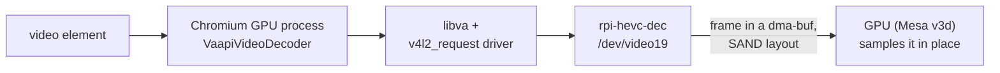

# Zero-copy HEVC decoding on the Raspberry Pi, in Chromium

The `live-display` branch is [megi's VA-API driver](https://xff.cz/git/libva-v4l2_request) plus six
patches. With them, Chromium-based applications (Chromium, Electron) decode HEVC with the Raspberry
Pi HEVC decoder (`rpi-hevc-dec`) and display the frames without any copy. FFmpeg works too.

Tested on a Raspberry Pi 4 with Raspberry Pi OS (64-bit) and Chromium 150.

## Contents

- [Branches and tags](#branches-and-tags)
- [How it works](#how-it-works)
- [Patches](#patches)
- [Build and install](#build-and-install)
- [Verify](#verify)
- [Use it in Chromium or Electron](#use-it-in-chromium-or-electron)
- [Debug](#debug)
- [Design decisions](#design-decisions)
- [Limits](#limits)
- [Update to a new upstream release](#update-to-a-new-upstream-release)
- [If something goes wrong](#if-something-goes-wrong)

## Branches and tags

| Ref | Content | Rule |
|---|---|---|
| `master` | Exact mirror of megi's `master` | Only fast-forwarded from `upstream`, never committed to |
| `live-display` | `master` at a tested commit + the patches + this file | Rebased onto each new upstream release |
| `ld-N` tags | Tested builds | Set after a test on a Raspberry Pi, never moved |

The patches are never merged into `master`: rebasing keeps them as a short, readable series on top
of megi's code, ready to be proposed upstream.

## How it works

On Linux, Chromium reaches hardware decoders only through VA-API: its V4L2 decoders are built for
ChromeOS only. This driver turns VA-API calls into requests to a **stateless** V4L2 decoder: the
caller parses the stream and sends each frame with its parameters (V4L2 request API).



- **SAND layout**: `rpi-hevc-dec` writes frames in the Broadcom SAND tiled layout (columns
  128 bytes wide, `NV12MT_COL128`, 2 planes), never in linear NV12. The GPU reads SAND directly,
  described by the DRM modifier `DRM_FORMAT_MOD_BROADCOM_SAND128`.
- **Zero-copy**: each frame stays in one dma-buf, a buffer shared by the decoder and the GPU.
- **Exported before decoding**: Chromium allocates its frame pool up front. It exports each VA
  surface once, before its first decode, then keeps sampling that dma-buf.
- **Decoding into the exported memory**: the driver imports each surface's buffer into the
  decoder (V4L2 `DMABUF` memory), so the decoder writes exactly where Chromium reads.
- **No fence**: the decoder attaches no fence to its buffers and Chromium never calls
  `vaSyncSurface()`. The driver waits for the decode of frames without references, the ones
  shown right away.

## Patches

| Commit | Without it | Change |
|---|---|---|
| Do not require a converter for tiled CAPTURE formats | `no usable format converter for Nc12, refusing hardware decoding` | A format without VA fourcc needs a converter only when it is linear |
| Queue multiplanar CAPTURE buffers with all their planes | `failed to queue CAPTURE buffer <n>: Invalid argument` | QBUF and DQBUF pass the plane count of the format (2 for `Nc12`) |
| Fall back to Broadcom SAND for the backing of unbound surfaces | Chromium: `vaExportSurfaceHandle failed` | A surface exported before decoding gets a SAND buffer when NV12 is refused |
| Export Broadcom SAND surfaces as separate layers | Chromium refuses the frame (`ChromeosStatusCode::3`, `kFailedToCreateVideoFrame`) | `VA_EXPORT_SURFACE_SEPARATE_LAYERS` also applies to SAND: one plane per layer |
| Decode into the surface backing through imported CAPTURE buffers | Pink and green picture: Chromium shows memory the decoder never writes | The CAPTURE queue imports each surface's buffer (`DMABUF`) when the decoder supports it and no converter is chained |
| Finish the decode of frames without references before returning | Orange and green tearing when a video starts, seeks or loops | `vaEndPicture()` waits for the decode of frames without references |

## Build and install

Run on the Raspberry Pi. Raspberry Pi OS ships kernel headers that define the SAND formats: on
other systems, the SAND code is left out at build time.

1. Install the build dependencies:

   ```bash
   sudo apt install -y git meson ninja-build pkg-config gcc libva-dev libdrm-dev vainfo && echo "OK: dependencies installed"
   ```

2. Clone the tag to install (`ld-1` here):

   ```bash
   git clone --branch ld-1 https://github.com/live-display/libva-v4l2_request.git ~/libva-v4l2_request && echo "OK: driver cloned"
   ```

3. Configure the build:

   ```bash
   meson setup ~/libva-v4l2_request/build ~/libva-v4l2_request && echo "OK: build configured"
   ```

4. Compile:

   ```bash
   ninja -C ~/libva-v4l2_request/build && echo "OK: driver built"
   ```

5. Install (into `/usr/lib/aarch64-linux-gnu/dri/v4l2_request_drv_video.so`):

   ```bash
   sudo ninja -C ~/libva-v4l2_request/build install && echo "OK: driver installed"
   ```

6. Check that the driver lists HEVC:

   ```bash
   sudo env LIBVA_DRIVER_NAME=v4l2_request vainfo 2>/dev/null | grep -q VAProfileHEVCMain && echo "OK: HEVC available" || echo "FAIL: HEVC not listed"
   ```

To remove it: `sudo ninja -C ~/libva-v4l2_request/build uninstall`.

## Verify

Decode the same HEVC clip in software, then in hardware, and compare the processor time. Run on
the Raspberry Pi; `sudo` gives access to the video devices (or add your user to the `video` and
`render` groups).

1. Install FFmpeg:

   ```bash
   sudo apt install -y ffmpeg && echo "OK: FFmpeg installed"
   ```

2. Encode any 1080p video as HEVC Main (the `hvc1` tag is what Chromium expects in MP4):

   ```bash
   ffmpeg -nostdin -loglevel error -y -i ~/sample.mp4 -c:v libx265 -preset ultrafast -profile:v main -pix_fmt yuv420p -crf 28 -tag:v hvc1 -c:a copy -movflags +faststart ~/test-hevc.mp4 && echo "OK: HEVC clip ready"
   ```

3. Decode it in software:

   ```bash
   ffmpeg -nostdin -nostats -benchmark -i ~/test-hevc.mp4 -f null - 2> ~/bench-software.txt && echo "OK: software decode done"
   ```

4. Decode it in hardware through the driver:

   ```bash
   sudo env LIBVA_DRIVER_NAME=v4l2_request ffmpeg -nostdin -nostats -benchmark -hwaccel vaapi -hwaccel_device /dev/dri/renderD128 -hwaccel_output_format vaapi -i ~/test-hevc.mp4 -f null - 2> ~/bench-hardware.txt && echo "OK: hardware decode done"
   ```

5. Compare the processor times (`utime`):

   ```bash
   grep -H "bench: utime" ~/bench-software.txt ~/bench-hardware.txt || echo "FAIL: a benchmark line is missing, read both files"
   ```

Measured on a Raspberry Pi 4, 28 s clip, 1080p30:

| Decoder | FFmpeg `utime` | Chromium: processor, renderer + GPU process | Chromium: dropped frames |
|---|---|---|---|
| Software (FFmpeg `hevc`) | about 32 s | Chromium has no software HEVC | — |
| Hardware (this driver) | about 1 s | about 24 % of 400 % | about 1 % |

## Use it in Chromium or Electron

| Setting | Why |
|---|---|
| Environment variable `LIBVA_DRIVER_NAME=v4l2_request` | libva cannot guess the driver of a Raspberry Pi |
| `--enable-features=VaapiIgnoreDriverChecks` | Chromium only trusts the Intel and AMD drivers otherwise |
| `--enable-features=PlatformHEVCDecoderSupport` | enables HEVC through a platform decoder |

Both features go in one switch: `--enable-features=VaapiIgnoreDriverChecks,PlatformHEVCDecoderSupport`.
The process also needs read and write access to `/dev/video19`, `/dev/media0` and
`/dev/dri/renderD128`.

Check it in a page: `MediaCapabilities.decodingInfo()` on `video/mp4; codecs="hvc1.1.6.L120.90"`
returns `supported: true` and `powerEfficient: true`.

## Debug

### Driver log

The driver writes to the standard error of the decoding process (the Chromium GPU process), every
line starting with `libva-v4l2request:`.

| Line | Meaning |
|---|---|
| `detected 1 Request API decoder` | the driver loaded and found `rpi-hevc-dec` |
| `no V4L2 Request API decoder found` | no stateless decoder: wrong board, or the HEVC decoder is not enabled in the kernel |
| `decoding hevc via /dev/video19 [rpi-hevc-dec] (media /dev/media0)` | a decode context started |
| `using CAPTURE format Nc12 (1920x1088), imported buffers` | **expected**: SAND output, decoded into the exported memory |
| `using CAPTURE format Nc12 (…), mmap buffers` | the decoder refused imported memory: a client that exports before decoding shows stale frames |
| `surface 0x… backing … does not fit CAPTURE …, reallocating` | a buffer was replaced after its export: that frame shows stale memory |
| `decode backing layout mismatch` | no buffer the decoder accepts could be allocated |
| `failed to queue CAPTURE buffer <n>: …` | the kernel refused an output buffer |
| `failed waiting on CAPTURE buffer <n>` | a decode did not finish within the timeout |
| `libva error: vaGetDriverNames() failed with operation failed` | **harmless**: libva's own lookup, printed even with `LIBVA_DRIVER_NAME` set |

`LIBVA_V4L2_TRACE=1` adds a line per buffer operation, with a monotonic timestamp: `bind surface`,
`QBUF CAPTURE`, `DQBUF CAPTURE … decode done`, waits and their duration. It is verbose (several
lines per frame): turn it on only to reproduce a problem.

### Chromium

Open `chrome://media-internals`, or the **Media** panel of the DevTools (in Electron: start it with
`--remote-debugging-port=9222`, then `chrome://inspect` on another computer, through an SSH tunnel
since the port listens on `127.0.0.1` only).

| Message or property | Meaning |
|---|---|
| `Decoder name: VaapiVideoDecoder`, `Hardware decoder: true` | **expected** |
| `vaExportSurfaceHandle failed, VA error: operation failed` (process log) | the driver could not export an unbound surface |
| `video decoder fallback after initial decode error`, then `Cannot select FFmpegVideoDecoder … kUnsupportedConfig` | VA-API failed and the build has no software HEVC: `PIPELINE_ERROR_DECODE` |
| Error caused by `ChromeosStatusCode::3` in `vaapi_video_decoder.cc` | the exported frame was refused: SAND exported as one layer with two planes |
| `GPU process exited unexpectedly: exit_code=11` (process log) | the GPU process crashed (`SIGSEGV`): reproduce with `LIBVA_V4L2_TRACE=1` and read the driver lines just before |

`HTMLVideoElement.getVideoPlaybackQuality()` gives `totalVideoFrames` and `droppedVideoFrames`:
read it twice, 10 s apart, to measure the dropped frames of a test.

### Kernel

1. List the output formats of the decoder (`Nc12`, `NC12`, `Nc30`, `NC30`):

   ```bash
   sudo v4l2-ctl -d /dev/video19 --list-formats
   ```

2. List its input formats (`S265`):

   ```bash
   sudo v4l2-ctl -d /dev/video19 --list-formats-out
   ```

3. Read the kernel messages of the decoder:

   ```bash
   sudo dmesg | grep -iE "hevc|rpivid" | tail -n 20
   ```

`v4l2-ctl` comes with `sudo apt install -y v4l-utils`.

## Design decisions

| Decision | Why |
|---|---|
| Import the surface buffers into the decoder, rather than copy decoded frames into them | a copy of every 1080p frame would cost what hardware decoding saves |
| Import only when the CAPTURE queue supports `DMABUF` and no converter is chained | other decoders and the converter path keep upstream's behaviour |
| Wait only for frames without references | waiting for every frame stops the decoder from working on two frames at once: measured, it doubled the dropped frames, while only frames shown right away (start, seek, loop) tore |
| Keep upstream's code untouched outside these paths | the series stays small and easy to rebase or upstream |

## Limits

- Only HEVC is accelerated: the Raspberry Pi 4 H.264 decoder (`bcm2835-codec`) is stateful, which
  this driver does not drive.
- Tested on a Raspberry Pi 4 only. The import path also changes the behaviour of other decoders
  that support `DMABUF` CAPTURE buffers, untested there.
- One GPU process crash (`SIGSEGV`) was seen once during development and never reproduced.

## Update to a new upstream release

Run on a computer, in a clone with `upstream` (megi) and `origin` (this repository) as remotes.

1. Fetch megi's changes:

   ```bash
   git -C ~/libva-v4l2_request fetch upstream --tags && echo "OK: upstream fetched"
   ```

2. Move to `master`:

   ```bash
   git -C ~/libva-v4l2_request switch master && echo "OK: on master"
   ```

3. Fast-forward the mirror (fails if `master` ever diverged, which must not happen):

   ```bash
   git -C ~/libva-v4l2_request merge --ff-only upstream/master && echo "OK: master updated"
   ```

4. Publish the mirror:

   ```bash
   git -C ~/libva-v4l2_request push origin master --tags && echo "OK: master pushed"
   ```

5. Move to `live-display`:

   ```bash
   git -C ~/libva-v4l2_request switch live-display && echo "OK: on live-display"
   ```

6. Replay the patches onto the new release ([If something goes wrong](#if-something-goes-wrong) on
   a conflict):

   ```bash
   git -C ~/libva-v4l2_request rebase master && echo "OK: patches replayed"
   ```

7. Publish the rewritten branch (tested builds stay reachable through their `ld-N` tags):

   ```bash
   git -C ~/libva-v4l2_request push --force-with-lease origin live-display && echo "OK: live-display pushed"
   ```

8. On a Raspberry Pi, build the branch ([Build and install](#build-and-install), cloning
   `--branch live-display`), then check:
   - [Verify](#verify): the hardware `utime` stays far below the software one;
   - in Chromium: `VaapiVideoDecoder`, the log line `imported buffers`, a clean picture when a
     looping video restarts, about 1 % of dropped frames.

9. Tag the tested build, with the next number:

   ```bash
   git -C ~/libva-v4l2_request tag -a ld-2 -m "Tested on upstream <version>" live-display && echo "OK: tag set"
   ```

10. Publish the tag:

    ```bash
    git -C ~/libva-v4l2_request push origin ld-2 && echo "OK: tag pushed"
    ```

## If something goes wrong

| Symptom | Fix |
|---|---|
| `vainfo` or FFmpeg: `Failed to open the given device` | no access to the video devices: use `sudo`, or add the user to `video` and `render` |
| FFmpeg: `no usable format converter for Nc12` | the upstream driver is installed: build this branch |
| Chromium uses `FFmpegVideoDecoder` for HEVC, or `supported: false` | `LIBVA_DRIVER_NAME` or the features are missing from the Chromium process |
| Black video, `PIPELINE_ERROR_DECODE` | read the Chromium message just before it ([Chromium](#chromium)) |
| Pink or green picture | the log says `mmap buffers`: the decoder refused imported memory |
| `vainfo` lists HEVC but Chromium shows a black or pink picture | the SAND code was left out at build time: build on Raspberry Pi OS, whose headers define `V4L2_PIX_FMT_NV12MT_COL128` |
| `rebase` stops on a conflict | megi changed the code a patch touches: edit the file, `git add` it, then `git rebase --continue`; to give up, `git rebase --abort` |
| `merge --ff-only` fails | someone committed to `master`: move those commits to `live-display`, then reset `master` to `upstream/master` |

## License

GPL-3.0-or-later, as upstream (`COPYING`).
